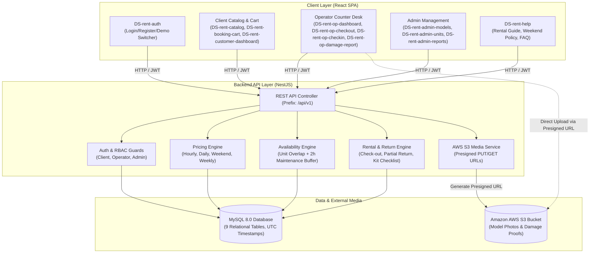

# Plan — RentCam Full-Stack Architecture & Implementation

## Size
L — Full-stack system initialization: MySQL schema & migrations (9 relational tables), AWS S3 media integration service, NestJS backend API with RBAC, availability engine with 2h maintenance buffer, F64 multi-tier pricing calculator, partial return & checklist counter workflows, React frontend with Light & Vibrant Studio Theme (5 modules: Client, Operator Desk, Admin, Auth, Help/FAQ), Docker Compose setup, and automated unit/e2e tests.

## Approach
Implement a decoupled multi-container architecture (Docker Compose) separating the MySQL 8 relational database, NestJS REST API backend, and React (Vite/TypeScript) SPA frontend.
- **Database Layer**: Clean relational schema with 9 tables (`users`, `equipment_models`, `pricing_tiers`, `physical_units`, `kit_checklist_items`, `rentals`, `rental_items`, `damage_reports`, `maintenance_logs`). All timestamps stored strictly in UTC (`DATETIME` / ISO 8601). Media references store only AWS S3 object keys and URLs (per [DECISIONS.md](file:///home/balici/Work/Proiect1-Web/docs/agents/DECISIONS.md#D-006)).
- **AWS S3 Media Service**: AWS SDK v3 service inside NestJS generating presigned upload/download URLs for equipment model photos and damage report incident evidence, keeping storage off local disks and preserving database performance. Supports mock/local S3 fallback (MinIO/LocalStack or direct simulated presigning) for offline development without AWS credentials.
- **NestJS Backend**: Modular architecture (`auth`, `users`, `equipment`, `pricing`, `rentals`, `damage`, `maintenance`, `media`). RBAC enforced via NestJS Guards (`JwtAuthGuard`, `RolesGuard` with `CLIENT`, `OPERATOR`, `ADMIN` roles per [DECISIONS.md](file:///home/balici/Work/Proiect1-Web/docs/agents/DECISIONS.md#D-004)). Multi-tier pricing engine evaluates hourly, daily, weekend (Friday 16:00 - Monday 11:00 @ ~1.5x daily), and 7-day weekly packages (per [DECISIONS.md](file:///home/balici/Work/Proiect1-Web/docs/agents/DECISIONS.md#D-003)). Availability engine calculates conflict overlaps incorporating an automated 2-hour maintenance buffer window between rentals.
- **React Frontend**: Modern React 18 + Vite + TypeScript application using TailwindCSS and CSS variables configured to match the Light & Vibrant Studio Theme (`#FFFDF9` cream-white, `#E11D48` studio red, `#F97316` orange, `#F59E0B` amber per [DECISIONS.md](file:///home/balici/Work/Proiect1-Web/docs/agents/DECISIONS.md#D-007)). Smooth photo transitions, active role switching (Demo fast-login), client catalog and booking cart, operator dispatch and check-in/partial return desk, admin inventory manager, and dedicated Help & FAQ section (`DS-rent-help` per [DECISIONS.md](file:///home/balici/Work/Proiect1-Web/docs/agents/DECISIONS.md#D-008)).
- **Docker Compose & Verification**: Multi-stage `docker-compose.yml` orchestrating `mysql`, `backend`, and `frontend`, with health checks, database seeding using demo data from `DATA.md`, Vitest for frontend unit tests, Jest for backend unit/e2e tests, and Playwright for headless UI screenshot validation.

## Architecture & Data Flow

---

## 1. Database Schema & Migrations (9 Tables)

All tables use `InnoDB`, `utf8mb4_unicode_ci`, and store timestamps in UTC (`DATETIME(3)` / `TIMESTAMP`). Foreign keys enforce referential integrity.

### Table Specifications:
1. `users`:
   - `id` (VARCHAR(36) UUID / INT AUTO_INCREMENT PRIMARY KEY)
   - `email` (VARCHAR(255) UNIQUE NOT NULL)
   - `password_hash` (VARCHAR(255) NOT NULL)
   - `full_name` (VARCHAR(255) NOT NULL)
   - `phone` (VARCHAR(50))
   - `role` (ENUM('client', 'operator', 'admin') NOT NULL DEFAULT 'client')
   - `customer_type` (ENUM('individual', 'company') DEFAULT 'individual')
   - `company_name` (VARCHAR(255) NULL)
   - `company_cui` (VARCHAR(50) NULL)
   - `created_at`, `updated_at` (DATETIME NOT NULL DEFAULT CURRENT_TIMESTAMP)

2. `equipment_models`:
   - `id` (VARCHAR(64) PRIMARY KEY, e.g. `MOD-FX3`)
   - `category_code` (VARCHAR(32) NOT NULL, e.g. `CAT-CAM`)
   - `category_name` (VARCHAR(100) NOT NULL)
   - `name` (VARCHAR(255) NOT NULL)
   - `manufacturer` (VARCHAR(100) NOT NULL)
   - `short_description` (TEXT NOT NULL)
   - `specifications` (JSON NOT NULL)
   - `primary_image_url` (VARCHAR(512) NOT NULL) -- S3 URL / Object Key
   - `gallery_images` (JSON NOT NULL) -- Array of S3 URLs
   - `deposit_amount` (DECIMAL(10, 2) NOT NULL)
   - `is_active` (BOOLEAN NOT NULL DEFAULT TRUE)
   - `created_at`, `updated_at` (DATETIME NOT NULL DEFAULT CURRENT_TIMESTAMP)

3. `pricing_tiers`:
   - `id` (INT AUTO_INCREMENT PRIMARY KEY)
   - `equipment_model_id` (VARCHAR(64) NOT NULL, FK -> equipment_models.id ON DELETE CASCADE)
   - `hourly_rate` (DECIMAL(10, 2) NULL)
   - `daily_rate` (DECIMAL(10, 2) NOT NULL)
   - `weekend_rate` (DECIMAL(10, 2) NOT NULL) -- Standard ~1.5x daily (Friday 16:00 - Monday 11:00)
   - `weekly_rate` (DECIMAL(10, 2) NOT NULL) -- Discounted ~4x daily
   - `created_at`, `updated_at` (DATETIME NOT NULL DEFAULT CURRENT_TIMESTAMP)

4. `physical_units`:
   - `id` (INT AUTO_INCREMENT PRIMARY KEY)
   - `equipment_model_id` (VARCHAR(64) NOT NULL, FK -> equipment_models.id)
   - `inventory_code` (VARCHAR(64) UNIQUE NOT NULL, e.g. `RC-CAM-001`)
   - `serial_number` (VARCHAR(128) NOT NULL, e.g. `SN-FX3-4819201`)
   - `status` (ENUM('available', 'rented', 'maintenance', 'retired') NOT NULL DEFAULT 'available')
   - `condition_notes` (TEXT NULL)
   - `last_inspected_at` (DATETIME NULL)
   - `created_at`, `updated_at` (DATETIME NOT NULL DEFAULT CURRENT_TIMESTAMP)

5. `kit_checklist_items`:
   - `id` (INT AUTO_INCREMENT PRIMARY KEY)
   - `equipment_model_id` (VARCHAR(64) NOT NULL, FK -> equipment_models.id ON DELETE CASCADE)
   - `item_name` (VARCHAR(255) NOT NULL, e.g. "Acumulator Sony NP-FZ100")
   - `quantity` (INT NOT NULL DEFAULT 1)
   - `is_critical` (BOOLEAN NOT NULL DEFAULT TRUE)
   - `created_at` (DATETIME NOT NULL DEFAULT CURRENT_TIMESTAMP)

6. `rentals`:
   - `id` (VARCHAR(36) UUID / INT AUTO_INCREMENT PRIMARY KEY)
   - `rental_code` (VARCHAR(32) UNIQUE NOT NULL, e.g. `RC-2026-0849`)
   - `user_id` (VARCHAR(36) / INT NOT NULL, FK -> users.id)
   - `status` (ENUM('pending', 'confirmed', 'active', 'partially_returned', 'completed', 'cancelled') NOT NULL DEFAULT 'confirmed')
   - `start_date` (DATETIME NOT NULL) -- UTC
   - `end_date` (DATETIME NOT NULL) -- UTC
   - `total_price` (DECIMAL(10, 2) NOT NULL)
   - `total_deposit` (DECIMAL(10, 2) NOT NULL)
   - `deposit_status` (ENUM('pending', 'held', 'partially_refunded', 'refunded', 'forfeited') NOT NULL DEFAULT 'held')
   - `created_at`, `updated_at` (DATETIME NOT NULL DEFAULT CURRENT_TIMESTAMP)

7. `rental_items`:
   - `id` (INT AUTO_INCREMENT PRIMARY KEY)
   - `rental_id` (FK -> rentals.id ON DELETE CASCADE)
   - `equipment_model_id` (VARCHAR(64) NOT NULL, FK -> equipment_models.id)
   - `physical_unit_id` (INT NULL, FK -> physical_units.id) -- Assigned at check-out
   - `status` (ENUM('reserved', 'checked_out', 'returned', 'damaged') NOT NULL DEFAULT 'reserved')
   - `checked_out_at` (DATETIME NULL)
   - `checked_in_at` (DATETIME NULL) -- Supports partial returns
   - `checklist_out_verified` (JSON NULL) -- Checklist state at dispatch
   - `checklist_in_verified` (JSON NULL) -- Checklist state at reception
   - `item_price` (DECIMAL(10, 2) NOT NULL)
   - `item_deposit` (DECIMAL(10, 2) NOT NULL)

8. `damage_reports`:
   - `id` (INT AUTO_INCREMENT PRIMARY KEY)
   - `rental_item_id` (INT NOT NULL, FK -> rental_items.id)
   - `physical_unit_id` (INT NOT NULL, FK -> physical_units.id)
   - `reported_by_user_id` (FK -> users.id)
   - `severity` (ENUM('minor', 'moderate', 'severe', 'total_loss') NOT NULL)
   - `description` (TEXT NOT NULL)
   - `estimated_cost` (DECIMAL(10, 2) NOT NULL DEFAULT 0.00)
   - `deposit_deduction` (DECIMAL(10, 2) NOT NULL DEFAULT 0.00)
   - `photo_urls` (JSON NOT NULL) -- Array of S3 URLs/Keys
   - `created_at` (DATETIME NOT NULL DEFAULT CURRENT_TIMESTAMP)

9. `maintenance_logs`:
   - `id` (INT AUTO_INCREMENT PRIMARY KEY)
   - `physical_unit_id` (INT NOT NULL, FK -> physical_units.id)
   - `maintenance_type` (ENUM('cleaning', 'turnover_buffer', 'repair', 'calibration', 'routine_check') NOT NULL)
   - `start_time` (DATETIME NOT NULL)
   - `end_time` (DATETIME NOT NULL)
   - `notes` (TEXT NULL)
   - `created_at` (DATETIME NOT NULL DEFAULT CURRENT_TIMESTAMP)

---

## 2. AWS S3 Media Service (Free Tier Compliant)

- **Architecture**:
  - Direct upload with Presigned URLs (`@aws-sdk/s3-request-presigner` & `@aws-sdk/client-s3`).
  - Endpoint `POST /api/v1/media/presign-upload` takes `{ fileName, fileType, folder: 'models' | 'damage-reports' | 'units' }`, verifies operator/admin authorization, and issues a presigned `PUT` URL valid for 15 minutes.
  - Endpoint `GET /api/v1/media/presign-download` allows obtaining secure access for protected damage inspection assets.
  - S3 paths partitioned:
    - `models/{modelId}/{filename}` (public-read or cloudfront CDN cached)
    - `damage-reports/{rentalCode}/{unitCode}/{timestamp}-{filename}` (restricted access)
  - Database stores relative S3 object keys (e.g. `damage-reports/RC-2026-0849/RC-CAM-001/sensor-scratch.webp`) or full S3 URLs.
  - Local Mock / Fallback Driver: If AWS credentials (`AWS_ACCESS_KEY_ID`, `AWS_SECRET_ACCESS_KEY`, `AWS_REGION`, `AWS_S3_BUCKET`) are not provided in development, the service gracefully switches to a local static/mock presigner serving mock static URLs so local development requires zero external setup.

---

## 3. NestJS Backend API & Domain Engines

- **RBAC & Security**:
  - Passport JWT strategy. Roles: `client`, `operator`, `admin`.
  - Global guards: `JwtAuthGuard` (with `@Public()` decorator for public catalog/pricing/help endpoints) and `RolesGuard` (`@Roles('operator', 'admin')`).
  - Built-in seed accounts:
    - Client: `client@rentcam.ro` / `RentCam2026!`
    - Operator: `operator@rentcam.ro` / `RentCam2026!`
    - Admin: `admin@rentcam.ro` / `RentCam2026!`
- **Availability Engine with 2-Hour Maintenance Buffer**:
  - When querying model availability for interval `[Start, End]`:
  - Each rental occupies `[rental.start_date, rental.end_date + 2 HOURS]`.
  - Active maintenance logs on physical units block unit availability for `[maintenance.start_time, maintenance.end_time]`.
  - Available units count for a model = `Total Active Units - Overlapping Bookings/Maintenance`.
- **F64-Style Pricing Calculation Engine (`/api/v1/rentals/quote`)**:
  - Input: `items: [{ modelId, quantity }]`, `startDate`, `endDate`.
  - Evaluates duration:
    1. **Weekend Promotion**: If `startDate` is Friday >= 14:00 (standard F64 pickup 16:00) and `endDate` is Monday <= 12:00 (standard return 11:00), applies the promotional `weekend_rate` (~1.5x daily).
    2. **Weekly Rate**: If duration >= 7 days, bundles 7-day increments at `weekly_rate` (4x daily) plus remaining daily rate.
    3. **Daily / Hourly Rate**: Standard 24h block calculation; hourly pricing if duration < 12h and hourly rate is defined.
  - Computes total rental price + total refundable deposit.
- **Counter Operations & Partial Return Workflow**:
  - `POST /api/v1/rentals/:id/checkout`: Operator verifies checklist items for each unit; sets unit status to `rented`, rental item status to `checked_out`, rental status to `active`.
  - `POST /api/v1/rentals/:id/checkin`: Operator selects individual `rental_item_id`s being returned.
    - If all items returned: rental status becomes `completed`.
    - If subset of items returned: rental status becomes `partially_returned`.
    - Automated creation of `maintenance_logs` with a 2-hour turnover buffer (`turnover_buffer`) from `checked_in_at` to `checked_in_at + 2h`.
    - Deposit settlement: unlocks deposit pro-rata minus any damage deductions.

---

## 4. React Frontend (Light & Vibrant Studio Theme)

Built using Vite + React + TypeScript + TailwindCSS, implementing the tokens from `docs/design/DESIGN.md` and mock workflows:
- **Theme & Styling**:
  - Warm cream background (`#FFFDF9`), crisp white surfaces (`#FFFFFF`), energetic rose/red accent (`#E11D48`), vibrant orange (`#F97316`), warm amber (`#F59E0B`).
  - Dynamic smooth photo animations (`--motion-image: 300ms cubic-bezier(0.4, 0, 0.2, 1)`) with scale on hover.
  - Light/Dark mode switcher adhering to token tables.
- **Modules**:
  1. **Auth & Quick Demo Bar (`DS-rent-auth`)**: Toggle between Client / Operator / Admin quick demo login for 1-click evaluation; tabbed login/register with individual vs company fields.
  2. **Client Module**:
     - `DS-rent-catalog`: Hero banner, animated marquee of featured equipment, live category filter, search, rental calendar widget with automatic weekend badge detection.
     - `DS-rent-equipment-detail`: Multi-angle AWS S3 photo gallery, specifications, kit contents checklist preview, dynamic pricing calculator showing 1-day, weekend, and 7-day savings.
     - `DS-rent-booking-cart`: Cart review, pickup/return datetime picker, deposit summary, checkout agreement.
     - `DS-rent-customer-dashboard`: Active rentals with return countdown, deposit refund tracking, historical bookings.
  3. **Operator Desk Module**:
     - `DS-rent-op-dashboard`: Front-desk dispatch schedule (today's pickups & returns), quick serial barcode/inventory code lookup.
     - `DS-rent-op-checkout`: Physical unit serial number selection, step-by-step kit accessory checklist verification, customer signature / handoff confirmation.
     - `DS-rent-op-checkin`: Multi-unit list supporting **partial return**, condition review, kit checklist verification.
     - `DS-rent-op-damage-report`: Interactive incident reporter with photo upload (AWS S3 presigned URL), damage severity selector (`minor`, `moderate`, `severe`, `total_loss`), and deposit penalty calculation.
     - `DS-rent-op-maintenance`: Maintenance backlog view, quick 2-hour buffer release or repair extension.
  4. **Admin Module**:
     - `DS-rent-admin-models`: Equipment model CRUD, specifications editor, tier pricing editor, accessory kit configurator.
     - `DS-rent-admin-units`: Inventory asset management, serial number tracking, operational status toggles.
     - `DS-rent-admin-reports`: Revenue statistics, fleet utilization rate, damage metrics.
  5. **Help & Rental Guide (`DS-rent-help`)**:
     - 4-step rental process guide, F64-style weekend schedule explainer (Friday 16:00 - Monday 11:00), deposit policy FAQ, operator handoff instructions.

---

## 5. Docker Compose & Verification Setup

- `docker-compose.yml` orchestrating:
  - `mysql`: MySQL 8.0 with healthcheck, persistent volume, and automatic schema initialization scripts.
  - `backend`: NestJS Node 20 alpine, runs TypeORM/Knex/Prisma/SQL migrations and seeds data from `DATA.md` on startup.
  - `frontend`: Vite React dev/nginx container exposing port 5173 / 80.
- Single command startup: `docker compose up --build`.

---

## Files

| Action | Path | What |
|---|---|---|
| NEW | `docker-compose.yml` | Multi-container setup (mysql, backend, frontend) |
| NEW | `.env.example` | Template for MySQL, JWT, AWS S3, and API URLs |
| NEW | `backend/package.json` | NestJS dependencies (TypeORM/MySQL2, AWS SDK v3, JWT, Passport, Class-Validator) |
| NEW | `backend/tsconfig.json` | TypeScript configuration for NestJS |
| NEW | `backend/src/main.ts` | NestJS bootstrap with `/api/v1` prefix and global validation pipes |
| NEW | `backend/src/app.module.ts` | Root NestJS module importing database, auth, models, rentals, media |
| NEW | `backend/src/database/migrations/*` | Relational SQL migrations creating the 9 tables with foreign keys and indices |
| NEW | `backend/src/database/seeds/*` | Database seeder importing categories, models, physical units, and kit checklists from `DATA.md` |
| NEW | `backend/src/modules/auth/*` | Auth controller, service, JWT strategy, roles guard, demo login endpoints |
| NEW | `backend/src/modules/media/*` | AWS S3 service (presigned URLs for uploads/downloads with local mock fallback) |
| NEW | `backend/src/modules/equipment/*` | Equipment models and physical units controllers, services, DTOs |
| NEW | `backend/src/modules/pricing/*` | Multi-tier pricing calculation engine (hourly, daily, weekend, weekly) |
| NEW | `backend/src/modules/availability/*` | Calendar availability engine with 2h maintenance buffer calculation |
| NEW | `backend/src/modules/rentals/*` | Booking controller, checkout, check-in (partial return support), checklist handling |
| NEW | `backend/src/modules/damage/*` | Damage report controller and service, S3 photo evidence linking, deposit deduction |
| NEW | `backend/src/modules/maintenance/*` | Physical unit maintenance logging and turnover buffer management |
| NEW | `frontend/package.json` | React 18, Vite, TypeScript, TailwindCSS, Lucide icons, Axios |
| NEW | `frontend/vite.config.ts` | Vite configuration with proxy to `/api/v1` |
| NEW | `frontend/tailwind.config.js` | Theme token configuration (`#FFFDF9`, `#E11D48`, `#F97316`, `#F59E0B`) |
| NEW | `frontend/src/index.css` | Token definitions, studio theme styling, dynamic photo animations |
| NEW | `frontend/src/App.tsx` | App router, role switcher bar, navigation bar, footer |
| NEW | `frontend/src/context/AuthContext.tsx` | Active role context (Client, Operator, Admin) with token persistence |
| NEW | `frontend/src/pages/auth/AuthPage.tsx` | `DS-rent-auth` login/registration and demo quick-switcher |
| NEW | `frontend/src/pages/catalog/CatalogPage.tsx` | `DS-rent-catalog` equipment catalog, filters, weekend badge |
| NEW | `frontend/src/pages/catalog/EquipmentDetailPage.tsx` | `DS-rent-equipment-detail` gallery, specs, kit checklist, rate calculator |
| NEW | `frontend/src/pages/booking/BookingCartPage.tsx` | `DS-rent-booking-cart` booking checkout, calendar date picker |
| NEW | `frontend/src/pages/customer/CustomerDashboardPage.tsx` | `DS-rent-customer-dashboard` active rentals and deposit tracker |
| NEW | `frontend/src/pages/operator/OperatorDashboardPage.tsx` | `DS-rent-op-dashboard` dispatch and return schedules |
| NEW | `frontend/src/pages/operator/CheckOutPage.tsx` | `DS-rent-op-checkout` serial assignment & kit checklist inspection |
| NEW | `frontend/src/pages/operator/CheckInPage.tsx` | `DS-rent-op-checkin` partial return & kit verification |
| NEW | `frontend/src/pages/operator/DamageReportPage.tsx` | `DS-rent-op-damage-report` damage inspection with S3 photo upload |
| NEW | `frontend/src/pages/operator/MaintenancePage.tsx` | `DS-rent-op-maintenance` turnover buffer & repair management |
| NEW | `frontend/src/pages/admin/AdminModelsPage.tsx` | `DS-rent-admin-models` equipment models & pricing tier management |
| NEW | `frontend/src/pages/admin/AdminUnitsPage.tsx` | `DS-rent-admin-units` physical units & serial number management |
| NEW | `frontend/src/pages/admin/AdminReportsPage.tsx` | `DS-rent-admin-reports` fleet utilization & financial metrics |
| NEW | `frontend/src/pages/help/RentalHelpPage.tsx` | `DS-rent-help` rental steps, weekend guide, deposit policies, FAQs |
| MODIFY | `docs/agents/CONTRACTS.md` | Update C-001 from `proposed` to `approved` reflecting confirmed endpoint contracts |
| MODIFY | `docs/agents/OPEN-QUESTIONS.md` | Record confirmed developer answers for Q-001, Q-002, Q-003, Q-004 |
| MODIFY | `AGENTS.md` | Update section 2 with concrete commands for install, build, run, test, and lint |

---

## Tests

| # | Behaviour | Test (file · kind) | Not automated? why |
|---|---|---|---|
| 1 | Database schema migrations create 9 tables with foreign keys | `backend/test/migrations.spec.ts` · integration | Automated |
| 2 | S3 media service generates valid presigned PUT/GET URLs & supports local mock | `backend/test/media-s3.spec.ts` · unit | Automated |
| 3 | Pricing engine calculates optimal price for 1 day, weekend promo, and 7-day weekly | `backend/test/pricing.spec.ts` · unit | Automated |
| 4 | Availability engine blocks unit during booking + 2h maintenance turnover buffer | `backend/test/availability.spec.ts` · unit | Automated |
| 5 | Partial return updates returned item status and keeps unreturned items active | `backend/test/partial-return.spec.ts` · integration | Automated |
| 6 | RBAC guards restrict operator desk and admin routes to authorized roles | `backend/test/rbac.spec.ts` · e2e | Automated |
| 7 | Frontend catalog filters models by category and responds to search queries | `frontend/src/pages/catalog/__tests__/Catalog.test.tsx` · unit | Automated |
| 8 | Dynamic pricing calculator updates quote when weekend date range is chosen | `frontend/src/pages/catalog/__tests__/PricingCalc.test.tsx` · unit | Automated |
| 9 | Check-in checklist requires inspecting all kit accessories before completion | `frontend/src/pages/operator/__tests__/CheckIn.test.tsx` · unit | Automated |

---

## Design (UI only)
- **Screens Covered**: `DS-rent-catalog`, `DS-rent-equipment-detail`, `DS-rent-booking-cart`, `DS-rent-customer-dashboard`, `DS-rent-op-dashboard`, `DS-rent-op-checkout`, `DS-rent-op-checkin`, `DS-rent-op-damage-report`, `DS-rent-op-maintenance`, `DS-rent-admin-models`, `DS-rent-admin-units`, `DS-rent-admin-reports`, `DS-rent-auth`, `DS-rent-help`.
- **Status in Registry**: All approved and aligned with existing HTML mocks in `docs/design/mocks/`.
- **Tokens Used**:
  - Background: `--color-bg` (`#FFFDF9` light / `#0f172a` dark)
  - Surface: `--color-surface` (`#ffffff` light / `#1e293b` dark)
  - Primary Red: `--color-primary` (`#E11D48` light / `#FB7185` dark)
  - Orange: `--color-accent-orange` (`#F97316` light / `#FB923C` dark)
  - Amber: `--color-accent-amber` (`#F59E0B` light / `#FBBF24` dark)
  - Border: `--color-border` (`#F1ECE4` light / `#334155` dark)
  - Animations: `--motion-image: 300ms cubic-bezier(0.4, 0, 0.2, 1)` for media card zoom.
- **States Covered**: Empty states (no rentals, no damaged items, empty search), Loading skeletons, Form error feedback, Success toasts, Light/Dark mode toggle.

---

## Sequencing
Multi-phase execution order:
1. **Phase 1: Database & Docker Foundation** — Docker Compose, MySQL 8 setup, 9-table schema migrations, seed dataset from `DATA.md`.
2. **Phase 2: Backend Core & AWS S3 Media** — NestJS scaffolding, JWT Auth & RBAC guards, S3 media presigning service with fallback mock.
3. **Phase 3: Domain Engines** — Pricing calculation engine (4 tiers), availability engine (2h maintenance buffer), rental dispatch & partial return workflow.
4. **Phase 4: Frontend Implementation** — Vite/React initialization, theme tokens, Auth/Demo switcher, Client module, Operator Desk, Admin module, Help & FAQ center.
5. **Phase 5: Automated Verification & Documentation** — Backend tests, frontend tests, ledger updates (C-001, Q-001..Q-004), and ledger lint verification.

---

## Risks
- **Risk**: External AWS S3 credentials may not be configured in the developer's local `.env`.
  - **Mitigation**: Implement a dual-mode Media Service that automatically detects missing AWS credentials and falls back to a simulated local presigned URL handler, ensuring the system runs seamlessly out of the box.
- **Risk**: Timezone skew between server, MySQL database, and client browsers causing availability calculation errors around weekend windows.
  - **Mitigation**: Standardize all database columns to UTC (`DATETIME` in UTC) and perform all duration calculations in UTC on the backend, only formatting to local Romanian time (`Europe/Bucharest`) on the UI display layer.

---

## Out of scope
- Integration with third-party real payment processors (Stripe/Netopia) for real credit card tokenization (tracked under `Q-011`, simulated for deposit holding).
- Physical barcode scanner hardware drivers (handled via standard text input / camera video stream emulation).
- Final commercial contract negotiations with RentCam partners (questions Q-005 through Q-010 remain open for client calibration; mock dataset from `DATA.md` used in the interim).

---

## Knowledge used
| Entry | What it says | Why it applies | Call |
|---|---|---|---|
| D-001 | Primary technology stack (React, NestJS, MySQL, Docker) | Defines core containerized architecture | confirm |
| D-002 | Two-tier inventory model (Models vs Physical Serials) | Defines database schema and tracking separation | confirm |
| D-003 | Multi-tier pricing (hourly, daily, weekend, weekly) | Informs the calculation engine algorithm in `/api/v1/rentals/quote` | confirm |
| D-004 | Role-based permissions (Client, Operator, Admin) | Defines NestJS guards and frontend view segregation | confirm |
| D-005 | Partial returns, accessory checklists, damage photo reporting | Dictates counter check-in workflow and damage reporting | confirm |
| D-006 | External media storage in Amazon AWS S3 | Prohibits DB BLOBs, dictates S3 presigned URL architecture | confirm |
| D-007 | Light & Vibrant Studio Theme inspired by F64 Rent | Governs color palette (`#FFFDF9`, `#E11D48`, etc.) and CSS styling | confirm |
| D-008 | Dedicated Rental Help and Guide section (DS-rent-help) | Requires inclusion of the Help & FAQ module | confirm |
| C-001 | Equipment rental management REST API | Specifies endpoint signatures and versioning (`/api/v1/`) | confirm |
| PATTERN-001 | Containerized environment with Docker | Application services configured via Docker Compose | confirm |
| Q-001 | Local development commands | Clarified by Docker Compose (`docker compose up --build`) | confirm |
| Q-002 | Automated test framework | Clarified by Jest (backend) & Vitest (frontend) | confirm |
| Q-003 | Build and lint commands | Clarified by `npm run build` and `npm run lint` | confirm |
| Q-004 | Automated UI screenshots | Clarified by Playwright script | confirm |

### Considered, not applied
- Flat single-table inventory: Rejected per D-002; physical unit serial tracking is required.
- Storing images in MySQL BLOBs: Rejected per D-006; AWS S3 object storage required.
- Single unified user dashboard: Rejected per D-004; clean separation of Client, Operator, and Admin is mandatory.

### Assumptions (no entry behind them)
- None. All requirements trace directly to approved decisions D-001 through D-008, approved patterns, and the design registry.
