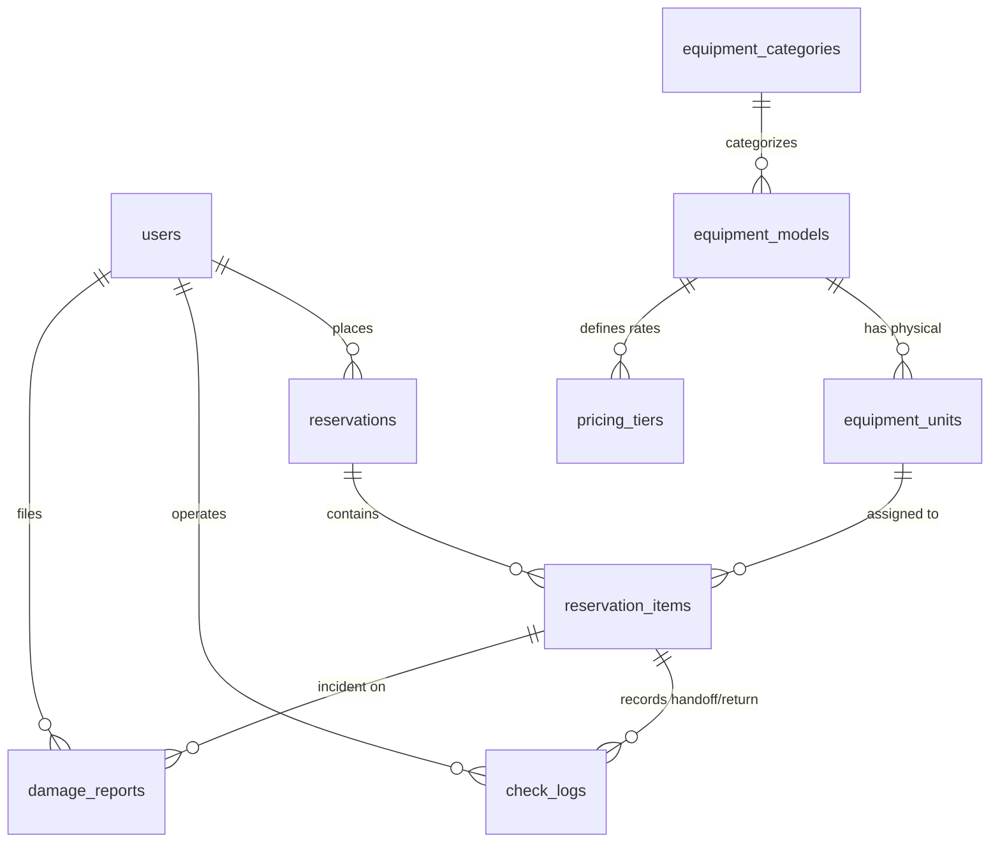

# Plan — RentCam MySQL DB Schema & Initial Migrations

> Approved implementation plan for RentCam MySQL DB schema and initial migrations adhering to the repo plan skill format, decisions D-001–D-005, and pattern PATTERN-001.

## Size
M — Initial relational database schema and migration infrastructure for RentCam equipment rental platform (9 core tables, constraints, foreign keys, indexes, and UTC timestamp enforcement).

## Approach
Implement the foundational MySQL 8.x relational schema and reproducible migration files for the 9 requested entities (`users`, `equipment_categories`, `equipment_models`, `equipment_units`, `pricing_tiers`, `reservations`, `reservation_items`, `check_logs`, `damage_reports`).

All date and time fields use `DATETIME` storing UTC values exclusively (standardized via session timezone `+00:00` and UTC constraints). The migrations are organized as clean, idempotent SQL scripts executable directly against MySQL (via Docker or migration runner) as well as configured within the NestJS backend database module (TypeORM / Knex / raw SQL migration framework), providing both direct SQL migration capabilities and containerized bootstrap.

### Alternatives rejected:
1. **ORMs with auto-sync in production (`synchronize: true`)**: Rejected because AGENTS.md hard rule 4 explicitly mandates that database changes must be performed through migrations.
2. **Local system timezone timestamps (`TIMESTAMP` dependent on server tz)**: Rejected in favor of explicit `DATETIME` in UTC with connection-level UTC enforcement (`+00:00`) to eliminate daylight saving ambiguities across rental contracts.

## Files
| Action | Path | What |
|---|---|---|
| NEW | `backend/database/migrations/001_initial_schema.sql` | Up and Down SQL migration script creating all 9 tables, indexes, unique constraints, and foreign keys in UTC |
| NEW | `backend/database/seeds/001_demo_seed.sql` | Seed script with provisional categories, models, units, and tiers from `DATA.md` |
| NEW | `backend/database/scripts/migrate.js` | Node/TypeScript migration runner script to execute migrations against MySQL container |
| NEW | `docker-compose.db.yml` | Dedicated or primary Docker Compose service definition for MySQL 8.0 with health checks and UTC timezone flag (`--default-time-zone=+00:00`) |
| NEW | `backend/database/README.md` | Instructions on executing migrations, rollback, and verification |
| MODIFY | `docs/agents/OPEN-QUESTIONS.md` | Note progress on database initialization related to Q-001 |

## Tests
| # | Behaviour | Test (file · kind) | Not automated? why |
|---|---|---|---|
| 1 | All 9 tables created with correct column types and default values | `backend/test/database/schema.spec.ts` · automated migration test | — |
| 2 | `equipment_units.serial_number` rejects duplicates (`UNIQUE` constraint) | `backend/test/database/constraints.spec.ts` · integration test | — |
| 3 | Partial return workflow: `reservation_items` can be transitioned to `'returned'` individually while parent `reservations` remains `'partially_returned'` | `backend/test/database/rental-integrity.spec.ts` · integration test | — |
| 4 | Check logs capture accessory snapshots and operator reference | `backend/test/database/check-logs.spec.ts` · integration test | — |
| 5 | Damage reports link to reservation items and store photo attachments JSON | `backend/test/database/damage-reports.spec.ts` · integration test | — |
| 6 | Idempotency & Rollback: migration down script cleanly tears down all 9 tables in reverse dependency order | `backend/test/database/rollback.spec.ts` · integration test | — |

## Design (UI only)
Not applicable (Database schema and migrations only; no UI code touched).

## Sequencing
one builder

## Risks
1. **Foreign key cycle or drop ordering**: Dropping or altering tables without respecting constraint order could fail.
   - *Mitigation*: Strictly defined dependency order in migration UP (`users`, `equipment_categories` -> `equipment_models` -> `pricing_tiers`, `equipment_units` -> `reservations` -> `reservation_items` -> `check_logs`, `damage_reports`) and reverse order in DOWN.
2. **Timezone drift between client/server and MySQL**:
   - *Mitigation*: Explicitly set `SET time_zone = '+00:00'` at migration initialization, configure MySQL container with `--default-time-zone='+00:00'`, and document that all application timestamps must be stored as UTC ISO strings.

## Out of scope
- Frontend UI components or client-side form validation.
- Stripe or external payment gateway integration (see Q-011).
- Object storage bucket upload pipeline (S3) for damage photo binaries (URLs/paths stored in DB JSON; file upload pipeline is separate).
- Real inventory and pricing production values (pending client meeting; see Q-005, Q-007; provisional data from `DATA.md` used for seeds).

## Knowledge used
| Entry | What it says | Why it applies | Call |
|---|---|---|---|
| D-001 | Primary tech stack: React, NestJS, MySQL, Docker | Schema must be MySQL 8.0 compliant and container-ready | confirm |
| D-002 | Two-tier inventory model and physical unit tracking | Defines separation between `equipment_models` and `equipment_units` (unique serials, accessory checklist) | confirm |
| D-003 | Multi-tier pricing and optimal rate calculation | Defines `pricing_tiers` table supporting hourly, daily, weekend, weekly rates | confirm |
| D-004 | Role-based permissions (Client, Operator, Admin) | Defines `users.role` ENUM (`client`, `operator`, `admin`) and foreign keys on logs/reports | confirm |
| D-005 | Partial returns, accessory checklists, and damage photo reporting | Requires `reservation_items` individual lifecycle, `check_logs` checklist JSON, and `damage_reports` photo attachments | confirm |
| PATTERN-001 | Containerized environment with Docker | MySQL and migration execution will run via Docker service | confirm |
| C-001 | Equipment rental management REST API | Database entities match the data contracts exposed by the REST endpoints | confirm |
| Q-005 | Real equipment inventory pending client confirmation | Provisional seeds used from `DATA.md` | confirm |
| Q-007 | Exact price tiers pending client confirmation | Provisional tiers used from `DATA.md` | confirm |
| Q-012 | Photo storage location for damage reports | Store JSON array of relative/S3 image URLs in DB | confirm |

### Considered, not applied
- *UUID primary keys instead of BIGINT UNSIGNED*: Considered for distributed scalability, but rejected in favor of `BIGINT UNSIGNED AUTO_INCREMENT` with public alphanumeric reference codes (`reservation_number`, `inventory_code`, `code`) to keep foreign key joins and indexing optimal in MySQL 8.

### Assumptions (no entry behind them)
- None. All table designs align directly with approved decisions D-001 through D-005 and `DATA.md`.

---

## Technical Specification & DDL Details

### Diagrama Entitate-Relație (ERD)

### Detalierea celor 9 Tabele (Toate Timestamp-urile în UTC)

#### 1. `users`
Utilizatori ai platformei cu roluri specifice (Client, Operator, Admin).
- `id`: `BIGINT UNSIGNED AUTO_INCREMENT PRIMARY KEY`
- `email`: `VARCHAR(191) NOT NULL UNIQUE`
- `password_hash`: `VARCHAR(255) NOT NULL`
- `first_name`: `VARCHAR(100) NOT NULL`
- `last_name`: `VARCHAR(100) NOT NULL`
- `phone`: `VARCHAR(30) NULL`
- `company_name`: `VARCHAR(150) NULL`
- `role`: `ENUM('client', 'operator', 'admin') NOT NULL DEFAULT 'client'`
- `is_active`: `BOOLEAN NOT NULL DEFAULT TRUE`
- `created_at`: `DATETIME NOT NULL DEFAULT CURRENT_TIMESTAMP`
- `updated_at`: `DATETIME NOT NULL DEFAULT CURRENT_TIMESTAMP ON UPDATE CURRENT_TIMESTAMP`

#### 2. `equipment_categories`
Clasificarea catalogului (Camere, Obiective, Lumini, Audio, Grip).
- `id`: `BIGINT UNSIGNED AUTO_INCREMENT PRIMARY KEY`
- `code`: `VARCHAR(50) NOT NULL UNIQUE` (ex: `CAT-CAM`)
- `name`: `VARCHAR(100) NOT NULL`
- `slug`: `VARCHAR(120) NOT NULL UNIQUE`
- `description`: `TEXT NULL`
- `icon`: `VARCHAR(50) NULL`
- `display_order`: `INT NOT NULL DEFAULT 0`
- `created_at`: `DATETIME NOT NULL DEFAULT CURRENT_TIMESTAMP`

#### 3. `equipment_models`
Definiția abstractă de produs (specificații, descriere, imagini, garanție de bază).
- `id`: `BIGINT UNSIGNED AUTO_INCREMENT PRIMARY KEY`
- `category_id`: `BIGINT UNSIGNED NOT NULL` (FK -> `equipment_categories.id` ON DELETE RESTRICT)
- `code`: `VARCHAR(50) NOT NULL UNIQUE` (ex: `MOD-FX3`)
- `brand`: `VARCHAR(100) NOT NULL`
- `name`: `VARCHAR(150) NOT NULL`
- `slug`: `VARCHAR(180) NOT NULL UNIQUE`
- `short_description`: `VARCHAR(255) NOT NULL`
- `full_specs`: `JSON NULL`
- `default_deposit`: `DECIMAL(10, 2) NOT NULL DEFAULT 0.00`
- `replacement_value`: `DECIMAL(10, 2) NOT NULL`
- `main_image_url`: `VARCHAR(255) NULL`
- `gallery_images`: `JSON NULL`
- `is_published`: `BOOLEAN NOT NULL DEFAULT TRUE`
- `created_at`: `DATETIME NOT NULL DEFAULT CURRENT_TIMESTAMP`
- `updated_at`: `DATETIME NOT NULL DEFAULT CURRENT_TIMESTAMP ON UPDATE CURRENT_TIMESTAMP`

#### 4. `pricing_tiers`
Matricea de tarife aplicabile pe model (orar, zilnic, weekend, săptămânal).
- `id`: `BIGINT UNSIGNED AUTO_INCREMENT PRIMARY KEY`
- `model_id`: `BIGINT UNSIGNED NOT NULL` (FK -> `equipment_models.id` ON DELETE CASCADE)
- `tier_type`: `ENUM('hourly', 'daily', 'weekend', 'weekly') NOT NULL`
- `price`: `DECIMAL(10, 2) NOT NULL`
- `currency`: `VARCHAR(3) NOT NULL DEFAULT 'RON'`
- `min_duration_hours`: `INT NOT NULL DEFAULT 1`
- `max_duration_hours`: `INT NULL`
- `created_at`: `DATETIME NOT NULL DEFAULT CURRENT_TIMESTAMP`
- `UNIQUE KEY uk_model_tier (model_id, tier_type)`

#### 5. `equipment_units`
Unitățile hardware fizice unice, seriale, stare și inventar kit accesorii.
- `id`: `BIGINT UNSIGNED AUTO_INCREMENT PRIMARY KEY`
- `model_id`: `BIGINT UNSIGNED NOT NULL` (FK -> `equipment_models.id` ON DELETE RESTRICT)
- `serial_number`: `VARCHAR(100) NOT NULL UNIQUE` (ex: `SN-FX3-4819201`)
- `inventory_code`: `VARCHAR(50) NOT NULL UNIQUE` (ex: `RC-CAM-001`)
- `barcode`: `VARCHAR(100) NULL UNIQUE`
- `status`: `ENUM('available', 'reserved', 'rented', 'maintenance', 'retired') NOT NULL DEFAULT 'available'`
- `included_accessories`: `JSON NOT NULL` (Array de obiecte: `[{ "id": "acc-1", "name": "2x NP-FZ100", "required": true }]`)
- `condition_notes`: `TEXT NULL`
- `purchase_date`: `DATE NULL`
- `created_at`: `DATETIME NOT NULL DEFAULT CURRENT_TIMESTAMP`
- `updated_at`: `DATETIME NOT NULL DEFAULT CURRENT_TIMESTAMP ON UPDATE CURRENT_TIMESTAMP`

#### 6. `reservations`
Tranzacții și contracte de închiriere.
- `id`: `BIGINT UNSIGNED AUTO_INCREMENT PRIMARY KEY`
- `reservation_number`: `VARCHAR(50) NOT NULL UNIQUE` (ex: `RES-2026-1002`)
- `user_id`: `BIGINT UNSIGNED NOT NULL` (FK -> `users.id` ON DELETE RESTRICT)
- `status`: `ENUM('draft', 'confirmed', 'active', 'partially_returned', 'completed', 'cancelled') NOT NULL DEFAULT 'draft'`
- `start_date`: `DATETIME NOT NULL`
- `end_date`: `DATETIME NOT NULL`
- `calculated_rental_price`: `DECIMAL(10, 2) NOT NULL DEFAULT 0.00`
- `total_deposit`: `DECIMAL(10, 2) NOT NULL DEFAULT 0.00`
- `deposit_status`: `ENUM('pending', 'held', 'partially_refunded', 'refunded', 'forfeited') NOT NULL DEFAULT 'pending'`
- `customer_notes`: `TEXT NULL`
- `created_at`: `DATETIME NOT NULL DEFAULT CURRENT_TIMESTAMP`
- `updated_at`: `DATETIME NOT NULL DEFAULT CURRENT_TIMESTAMP ON UPDATE CURRENT_TIMESTAMP`

#### 7. `reservation_items`
Elementele rezervate, asocierea unităților fizice și status individual (permite retur parțial).
- `id`: `BIGINT UNSIGNED AUTO_INCREMENT PRIMARY KEY`
- `reservation_id`: `BIGINT UNSIGNED NOT NULL` (FK -> `reservations.id` ON DELETE CASCADE)
- `model_id`: `BIGINT UNSIGNED NOT NULL` (FK -> `equipment_models.id` ON DELETE RESTRICT)
- `unit_id`: `BIGINT UNSIGNED NULL` (FK -> `equipment_units.id` ON DELETE SET NULL)
- `item_status`: `ENUM('booked', 'checked_out', 'returned', 'damaged', 'lost') NOT NULL DEFAULT 'booked'`
- `unit_rental_price`: `DECIMAL(10, 2) NOT NULL`
- `unit_deposit`: `DECIMAL(10, 2) NOT NULL`
- `checked_out_at`: `DATETIME NULL`
- `returned_at`: `DATETIME NULL`
- `created_at`: `DATETIME NOT NULL DEFAULT CURRENT_TIMESTAMP`

#### 8. `check_logs`
Auditul operațiunilor de ghișeu: verificare checklist accesorii la check-out și check-in.
- `id`: `BIGINT UNSIGNED AUTO_INCREMENT PRIMARY KEY`
- `reservation_item_id`: `BIGINT UNSIGNED NOT NULL` (FK -> `reservation_items.id` ON DELETE CASCADE)
- `operator_user_id`: `BIGINT UNSIGNED NOT NULL` (FK -> `users.id` ON DELETE RESTRICT)
- `action_type`: `ENUM('checkout', 'checkin', 'maintenance_start', 'maintenance_end') NOT NULL`
- `checklist_snapshot`: `JSON NOT NULL` (Verificarea bifată per accesoriu)
- `all_accessories_present`: `BOOLEAN NOT NULL DEFAULT TRUE`
- `operator_notes`: `TEXT NULL`
- `timestamp`: `DATETIME NOT NULL DEFAULT CURRENT_TIMESTAMP`

#### 9. `damage_reports`
Rapoarte de daune întocmite la recepție/retur, cu cost reparație estimat și poze atașate.
- `id`: `BIGINT UNSIGNED AUTO_INCREMENT PRIMARY KEY`
- `reservation_item_id`: `BIGINT UNSIGNED NOT NULL` (FK -> `reservation_items.id` ON DELETE CASCADE)
- `reported_by_operator_id`: `BIGINT UNSIGNED NOT NULL` (FK -> `users.id` ON DELETE RESTRICT)
- `severity`: `ENUM('cosmetic', 'functional_minor', 'critical', 'total_loss') NOT NULL`
- `description`: `TEXT NOT NULL`
- `estimated_repair_cost`: `DECIMAL(10, 2) NOT NULL DEFAULT 0.00`
- `photo_attachments`: `JSON NOT NULL` (Array de căi către fișiere: `["/uploads/damage/101-sensor.jpg", ...]`)
- `status`: `ENUM('under_review', 'deposit_deducted', 'resolved', 'waived') NOT NULL DEFAULT 'under_review'`
- `created_at`: `DATETIME NOT NULL DEFAULT CURRENT_TIMESTAMP`
- `resolved_at`: `DATETIME NULL`
